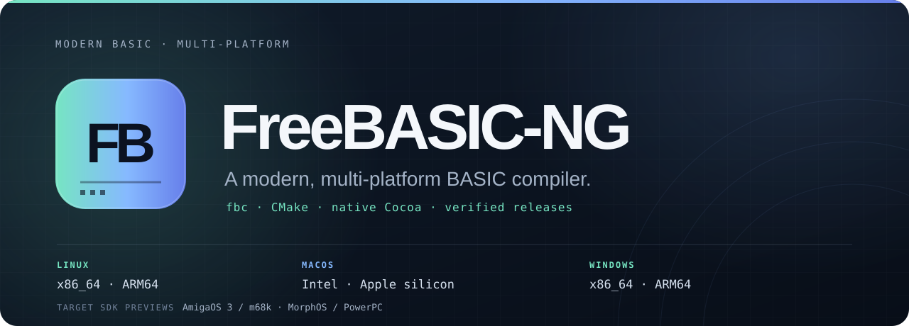

<p align="center">
  
</p>

<p align="center">
  <a href="https://github.com/metaneutrons/freebasic-ng/actions/workflows/ci.yml"></a>
  <a href="https://github.com/metaneutrons/freebasic-ng/releases/latest"></a>
  <a href="https://freebasic.metaneutrons.cc/"></a>
  <a href="LICENSE.md"></a>
</p>

<p align="center">
  <strong>Classic BASIC syntax. Current toolchains. Reproducible delivery.</strong><br>
  A FreeBASIC fork with CMake builds, native Cocoa graphics, six native release archives and preview SDKs for AmigaOS and MorphOS.
</p>

<p align="center">
  <a href="https://freebasic.metaneutrons.cc/">Install</a> ·
  <a href="#build-from-source">Build from source</a> ·
  <a href="docs/platform-support.md">Platform guide</a> ·
  <a href="https://github.com/metaneutrons/freebasic-ng/releases">Releases</a> ·
  <a href="CONTRIBUTING.md">Contribute</a>
</p>

---

FreeBASIC-NG is a fork of
[FreeBASIC](https://github.com/freebasic/fbc), the free and open-source BASIC
compiler with MS-QuickBASIC-compatible syntax. Existing source remains familiar,
and the compiler executable remains `fbc`. The fork adds a current build and
release foundation without claiming to be an official upstream distribution.

<table>
<tr>
<td width="33%" valign="top">
<h3>Modern builds</h3>
<p>CMake and Ninja, provenance-verified bootstrap compilers, GCC and Clang, and a reproducible staged installation.</p>
</td>
<td width="33%" valign="top">
<h3>Native platforms</h3>
<p>Tier 1 releases for Linux, macOS and Windows on x86-64 and ARM64, including a native Cocoa/CoreGraphics backend.</p>
</td>
<td width="33%" valign="top">
<h3>Verifiable delivery</h3>
<p>Qualified release archives, SHA-256 digests, Sigstore bundles, SPDX SBOMs and package-manager publication gates.</p>
</td>
</tr>
</table>

## Install

Open **[freebasic.metaneutrons.cc](https://freebasic.metaneutrons.cc/)** to
select an operating system and architecture. The site provides:

- complete release archives for every Tier 1 host;
- the required `deb.metaneutrons.cc` setup before `apt install freebasic-ng`;
- the `metaneutrons/homebrew-tap` route for macOS;
- AUR source and binary package routes; and
- checksums, Sigstore bundles and SPDX SBOMs for direct downloads.

The compiler, runtime and graphics libraries form one versioned distribution.
Upgrade them together; do not copy a new `fbc` over libraries from another
FreeBASIC-NG or upstream FreeBASIC version.

## Your first program

```basic
Print "Hello from FreeBASIC-NG"
Sleep
```

```console
$ fbc hello.bas
```

FreeBASIC-NG accepts the established FreeBASIC language and dialect options.
The fork focuses on compiler maintenance, current host support and reliable
distribution rather than introducing an incompatible language.

## Build from source

You need CMake 3.20 or newer, Ninja, a C compiler, Python 3, CA certificates and
ncurses on Linux or macOS.

```console
$ cmake -B build -G Ninja -DCMAKE_BUILD_TYPE=Release
$ cmake --build build
$ ./build/src/compiler/fbc --version
$ cmake --install build --prefix "$PWD/stage"
```

The default build materializes a target-specific bootstrap compiler whose
provenance is pinned and verified. It does not silently depend on an arbitrary
`fbc` from `PATH`. To opt into a local compiler explicitly, configure with
`-DFB_USE_SYSTEM_FBC=ON`. The [bootstrap guide](docs/bootstrap.md) documents
the trust chain, cache and offline reproduction procedure.

## Platform support

| Platform | Architecture | Status | Notes |
| --- | --- | --- | --- |
| Linux | x86_64, ARM64 | Tier 1 host | Compiler, runtime and graphics archives |
| macOS | Intel, Apple silicon | Tier 1 host | macOS 11+, native Cocoa/CoreGraphics; no XQuartz |
| Windows | x86_64, ARM64 | Tier 1 host | Native compiler, runtime and graphics archives |
| AmigaOS 3 | m68k | Developer-preview target | Cross-built SDK with emulator runtime evidence |
| MorphOS | PowerPC | Developer-preview target | Cross-built SDK with MorphOS 3.20 runtime evidence |
| AROS | — | Deferred | Qualification follows stable `aros-toolchains` and `aros-tools` inputs |

Windowed, borderless, always-on-top and fullscreen graphics modes are qualified
on Apple silicon. Detailed support boundaries, output conventions and manual
qualification records live in the [platform guide](docs/platform-support.md).

## Compatibility and identity

FreeBASIC-NG is based on the upstream 1.20.0 development line and aims for
source compatibility with that base. It does not claim ABI compatibility with
arbitrary FreeBASIC distributions. Package managers should treat it as an
alternative compiler distribution, not as a drop-in provider for an unrelated
`freebasic` package.

| Surface | Identity |
| --- | --- |
| Project | FreeBASIC-NG |
| Compiler executable | `fbc` |
| Debian and Homebrew package | `freebasic-ng` |
| AUR packages | `freebasic-ng`, `freebasic-ng-bin` |
| Release tags | `v<version>` |
| Release assets | `freebasic-ng-<version>-<platform>` |

See [UPSTREAM_BASE.md](UPSTREAM_BASE.md) for the exact upstream commit and the
fork compatibility policy.

## Documentation

| Start here | Project internals |
| --- | --- |
| [Install and downloads](https://freebasic.metaneutrons.cc/) | [Bootstrap trust chain](docs/bootstrap.md) |
| [Platform support](docs/platform-support.md) | [Release security](docs/release-security.md) |
| [Latest release notes](https://github.com/metaneutrons/freebasic-ng/releases/latest) | [Release procedure](docs/releasing.md) |
| [Contributing](CONTRIBUTING.md) | [Versioned roadmap](docs/plans/m0.md) |
| [Security policy](SECURITY.md) | [Repository history](docs/history/README.md) |

## Contributing

Read [CONTRIBUTING.md](CONTRIBUTING.md) before opening a pull request. Bug
reports should include the host and target architecture, compiler version,
complete command and a minimal reproducer. Report vulnerabilities through the
private process in [SECURITY.md](SECURITY.md), not a public issue.

## Licence and attribution

FreeBASIC-NG preserves the original copyright notices and component licences.
The compiler is GPL-2.0-or-later. `libfb` and `libfbgfx` are LGPL-2.1-or-later
with the existing static-linking exception. See [LICENSE.md](LICENSE.md) and the
notices alongside the respective sources.
